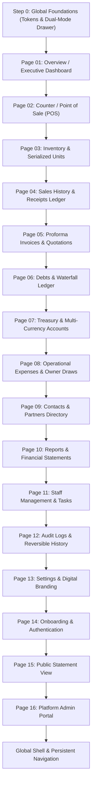

# Master UI/UX Execution Plan (2026 Page-by-Page Modernization)
**Project**: Finance SaaS Platform (Multi-Tenant Operating System for Retail, Distribution & Hardware Trading)  
**Living Document**: Tracked and updated at `/Users/hohitef/finance/UI_UX_PLAN.md`  
**Execution Philosophy**: **Editorial Minimalism** + purposeful **Liquid Glass** accents (2026 Human-Crafted UI/UX). Zero generic AI slop.  
**Review Gate Rule**: Every screen undergoes:
1. **Screen Audit & Design Specification**
2. **Desktop Implementation** -> User Inspection & Approval Checkpoint
3. **Mobile Implementation** -> User Inspection & Approval Checkpoint
4. **Marked [x] Complete**, only then advance to the next screen.

---

## 1. Design Direction & Anti-Slop Architectural Rules

### What We Are Eliminating ("AI Slop"):
1. **Arbitrary Pixel Font Classes**: Eradicating 1,964 instances of `text-[9px]`, `text-[10px]`, `text-[11px]`, `text-[13px]`, `text-[15px]` in favor of a strictly structured typographic scale (`text-xs`, `text-sm`, `text-base`, `text-lg`, `text-xl`, `text-2xl`) using semantic font weights and line heights.
2. **Nested Card Syndrome ("Bento Russian Dolls")**: Eliminating cards wrapped in cards with outer borders, inner borders, and badge borders. Structural separation will use clean editorial whitespace, subtle rule-lines (`divide-slate-100 dark:divide-slate-800`), and typography contrast rather than stacked rounded boxes.
3. **Gratuitous Glassmorphism (`backdrop-blur`)**: Replacing 86 blanket blur calls with sharp, high-contrast, performant surfaces. Frosted glass (`backdrop-blur-md`) is restricted exclusively to floating sticky headers, interactive navigation bars, and modal overlays.
4. **Generic AI Gradient Blends**: Removing artificial dark-green-to-slate or purple-to-blue gradient fills (`bg-gradient-to-...`), floating glows, and synthetic skeuomorphism (such as fake 3D SVG gold bars or stacked curvy card silhouettes).
5. **Desktop Layouts Squeezed into Mobile**: Replacing side slide-overs with native draggable bottom sheets on screens `< 768px`, ensuring touch targets are $\ge 44\text{px}$, and providing card-list alternatives to wide tabular data.

### 2026 Visual Language ("Human-Crafted Editorial Minimalism"):
- **Typography Hierarchy**: Clear editorial mastheads, bold numerical data in monospace tabular figures (`font-mono tabular-nums`), secondary labels in refined uppercase tracking (`text-[11px] font-semibold tracking-wider text-slate-400 uppercase`).
- **Surface & Depth**: Subtle 1px neutral borders (`border-slate-200/80 dark:border-slate-800`), clean off-white page background (`bg-[#f8fafc] dark:bg-[#0b0f17]`), flat crisp white cards (`bg-white dark:bg-[#131926]`).
- **Purposeful Color Tokens**:
  - Primary Action / Brand: Restrained Forest Emerald (`#094838` dark mode, `#047857` light mode).
  - Status Indicators: Semantic emerald (positive/collected), rose (debt/payable/expense), amber (warning/pending inspection), slate (neutral).
  - Currency: JetBrains Mono tabular numbers with subdued currency denomination tags (`font-mono font-bold text-slate-900 dark:text-white` with `text-xs text-slate-400`).

---

## 2. Global Design System Foundations (Step 0)

Before executing views page-by-page, the shared foundations must be unified:

- [ ] **Task 0.1: Semantic Design Tokens in `index.css`**
  - Define unified typographic scale: `caption` (11px/14px), `body-sm` (12px/16px), `body` (14px/20px), `subhead` (16px/24px), `title` (20px/28px), `display` (28px/36px).
  - Standardize surface colors (`--surface-canvas`, `--surface-card`, `--surface-elevated`, `--surface-subtle`).
- [ ] **Task 0.2: Dual-Mode Drawer Architecture in [`SlideOverDrawer.tsx`](file:///Users/hohitef/finance/frontend/src/components/drawers/SlideOverDrawer.tsx)**
  - *Desktop (`md:`)*: Clean right slide-over with crisp border, keyboard escape-trap, backdrop dimming.
  - *Mobile (`< md`)*: Native draggable bottom sheet anchored to bottom, top drag-handle pill, swipe-down to dismiss, keyboard-avoiding `max-h-[92vh]`.

---

## 3. Page-by-Page Audit & Implementation Tracker

### Page 01: Overview / Executive Dashboard
**Files**: [`OverviewView.tsx`](file:///Users/hohitef/finance/frontend/src/views/OverviewView.tsx), [`MobileOverview.tsx`](file:///Users/hohitef/finance/frontend/src/components/dashboard/MobileOverview.tsx)  
**Purpose**: Executive financial summary (Working Capital Formula, Net Profit/Loss, Cash vs. Stock, Receivables & Payables).

- **AI Slop Audit**:
  - `MobileOverview.tsx`: Contains artificial stacked SVG card silhouettes with fake 3D curves (`HERO_CARD_PATH`), radial mesh gradients, and drop shadows (`floodColor="#01060c"`).
  - `OverviewView.tsx`: Capital strip contains nested rounded badges with arbitrary `text-[10px]` tags.
- **Design Recommendations**:
  - Replace the fake SVG curvy deck with an elegant, human-crafted Editorial Financial Masthead: large tabular net capital display with clean proportional asset breakdown bar.
  - Structure the 5 capital metrics (Stock, Receivables, Cash, Reserves, Payables) into a unified editorial grid without excessive card borders.
- **Desktop Cleanup Plan**:
  - Clean up the capital strip into an integrated horizontal masthead with compact sizing for 13" laptops (`1440x778`) scaling up dynamically on larger displays. Removed decorative icons from the 5 KPI items for an ultra-clean, minimalist editorial typography header.
  - Borderless white overview cards (`border-0 shadow-xs`) replacing harsh dark outlines.
  - Sidebar expanded to `w-72 2xl:w-80` with borderless white background, spacious padding, and independent vertical scroll.
  - Left greeting: `Good afternoon, Husni Kamil` with subtitle `Store Performance & Working Capital Overview`. Right persona button removed.
  - Height-matched middle row: Removed `flex flex-col justify-between` and the inner SVG box border to eliminate the bottom empty space. Sized both Sales Trajectory and Asset Allocation side-by-side at a matching ~180px height.
  - Asset Allocation Polish:
    - Donut ring geometry optimized: Reverted to bold, tactile fatness (`stroke = 22`, expanding to 26 on hover) and increased diameter to 182px (viewBox `190x190`, `radius = 80`). Leaves a generous 138px inner diameter for large typography (`Net Capital 10.44M ETB` and hover stats) while card height remains strictly fixed at `h-[180px] 2xl:h-[195px]`.
    - Positioned 3 executive health metrics (*Gross Assets*, *Debt Ratio*, *Liquid Share*) cleanly on the right side of the chart separated by a subtle vertical hairline divider, paired with the active hover segment inspection pill.
  - Monthly Performance typography calibrated: Compact, refined typography on 13" laptops (`text-[11px]` header, `text-[10px]` uppercase tags, `text-lg sm:text-xl` figures, `text-[10.5px]` subtitles) dynamically scaling up to `2xl:text-2xl` on larger screens.
  - Standardized debtor/creditor avatar initial boxes to `w-8 h-8 rounded-lg` for pixel-crisp alignment.
  - Renamed "Owed to You" to **Receivables** (green `text-emerald-600 dark:text-emerald-400`) and "You Owe" to **Payables** (red `text-rose-600 dark:text-rose-400`), matching the list number colors across both Desktop and Mobile views.
- **Mobile Cleanup Plan**:
  - Keep the curvature silhouette of the header card (`HERO_CARD_PATH` contour), but eliminate all pseudo-3D offset layers (`cardBackNavy`, `cardBackSage`), fake drop shadows (`feDropShadow`), and artificial mesh gradients.
  - Apply a clean, solid, high-contrast surface color (`#0f172a` slate-900 / dark emerald) to the curved card with crisp subtle border.
  - Remove holographic sheen sweep overlay (`animate-holo-sweep`).
  - Streamline quick metric buttons and performance cards into clean, responsive native touch targets with bottom-sheet drawer drill-downs.

**Status**:
- [x] 01.1 Desktop Audit & Redesign (Wider sidebar `w-72 2xl:w-80`, borderless cards, personalized greeting, removed right owner pill, centered enlarged Donut with interactive hover tooltips, Receivables/Payables semantic color parity, standardized `rounded-lg` button/avatar corner radiuses, and balanced `text-xl sm:text-2xl 2xl:text-3xl` performance figures)
- [x] 01.2 Desktop Modals & Drawers Cleanup (`RecordExpenseModal`, `RecordDebtModal`, `ManageAccountModal`, `AddBalanceModal`, `SplitPaymentSelector`, `VitalBreakdownDrawer`, `DebtDrawer`, `PartySettleModal`, and `SlideOverDrawer`—standardized `rounded-lg` tokens, `text-sm` inputs, `text-base` monospace monetary figures, calm editorial surfaces without saturated callout boxes, consistent Receivables/Payables terminology, semantic arrow parity, silky-smooth zero-shake entrance animation `animate-modal-smooth`, pinned header & pinned footer shells, and zero active input clipping)
- [x] 01.3 Mobile Header & Curvature Cleanup (Curvature silhouette preserved, layered 3D decks eliminated, solid `#0f172a` surface applied, text truncation & congestion resolved, un-outlined cards)
- [ ] 01.4 User Final Inspection & Approval Checkpoint
- [ ] **Page 01 Complete**

---

### Page 02: Counter / Point of Sale (POS)
**Files**: [`CounterView.tsx`](file:///Users/hohitef/finance/frontend/src/views/CounterView.tsx), [`AccessoryAttachmentSection.tsx`](file:///Users/hohitef/finance/frontend/src/components/counter/AccessoryAttachmentSection.tsx), [`VendorDirectSaleModal.tsx`](file:///Users/hohitef/finance/frontend/src/components/counter/VendorDirectSaleModal.tsx), [`ExchangeDeviceModal.tsx`](file:///Users/hohitef/finance/frontend/src/components/counter/ExchangeDeviceModal.tsx)  
**Purpose**: Fast-paced retail counter checkout, device picking, serial selection, split payments, customer assignment, and instant invoicing.

- **AI Slop Audit**:
  - Over 2,300 lines with nested containers inside containers.
  - Mobile step tracker uses miniature circular badges (`w-6 h-6 text-[10px]`) and cramped text.
  - Product search suggestions overlay has double rounded borders and arbitrary shadows (`shadow-2xl`).
- **Design Recommendations**:
  - Transform desktop into a sleek 2-column POS workspace: Left side is Model & Inventory Picker (search, categories, IMEI selector); Right side is Checkout Cart & Settlement Summary.
  - Standardize all inputs, quantity controls (`+` / `-`), and payment mode toggles to standard button tokens.
- **Desktop Cleanup Plan**:
  - Remove unnecessary step containers when desktop view has ample space.
  - Streamline product search suggestions dropdown with clean keyboard navigation indicators and clear stock availability chips.
- **Mobile Cleanup Plan**:
  - Build an ergonomic 4-step wizard with full-width native touch buttons ($\ge 48\text{px}$).
  - IMEI / serial selection drawer should open as a bottom sheet with search and quick-select checkboxes.

**Status**:
- [ ] 02.1 Desktop Audit & Redesign
- [ ] 02.2 Desktop User Review & Approval
- [ ] 02.3 Mobile Ergonomics & Wizard Redesign
- [ ] 02.4 Mobile User Review & Approval
- [ ] **Page 02 Complete**

---

### Page 03: Inventory & Serialized Units
**Files**: [`InventoryView.tsx`](file:///Users/hohitef/finance/frontend/src/views/InventoryView.tsx), [`StockIntakeModal.tsx`](file:///Users/hohitef/finance/frontend/src/components/inventory/StockIntakeModal.tsx), [`CategoryManagementModal.tsx`](file:///Users/hohitef/finance/frontend/src/components/inventory/CategoryManagementModal.tsx), [`EditProductModal.tsx`](file:///Users/hohitef/finance/frontend/src/components/inventory/EditProductModal.tsx), [`SwapDeviceModal.tsx`](file:///Users/hohitef/finance/frontend/src/components/inventory/SwapDeviceModal.tsx), [`InventoryUnitDrawer.tsx`](file:///Users/hohitef/finance/frontend/src/components/drawers/InventoryUnitDrawer.tsx)  
**Purpose**: Complete catalog & serial management (In Stock, Handover to Staff, Vendor Returns, Repairs, Warranty Tracking).

- **AI Slop Audit**:
  - 4,556 lines. Tab bar has 10 pill filters causing horizontal overflow without native scroll physics.
  - Heavy arbitrary typography (`text-[9px]`, `text-[10px]`, `text-[11px]`) across status badges and IMEI pills.
  - Device condition tags use neon pill colors.
- **Design Recommendations**:
  - Clean editorial status tabs: active underline indicators or restrained solid pills instead of colorful borders.
  - High-density data table on desktop with sticky columns, clean typography, and fast inline search.
- **Desktop Cleanup Plan**:
  - Standardize inventory table header and cell hierarchy.
  - Refactor action menus (Handover, Swap, Return, Repair) into clean contextual dropdowns.
- **Mobile Cleanup Plan**:
  - Transform wide tabular unit rows into tactile native mobile cards with prominent model title, IMEI chip, status badge, and one-tap action sheet.
  - Stock intake modal refactored to mobile-friendly full-height sheet.

**Status**:
- [ ] 03.1 Desktop Audit & Redesign
- [ ] 03.2 Desktop User Review & Approval
- [ ] 03.3 Mobile Cards & Touch Actions Redesign
- [ ] 03.4 Mobile User Review & Approval
- [ ] **Page 03 Complete**

---

### Page 04: Sales History & Receipts Ledger
**Files**: [`SalesHistoryView.tsx`](file:///Users/hohitef/finance/frontend/src/views/SalesHistoryView.tsx), [`SalesOrderDrawer.tsx`](file:///Users/hohitef/finance/frontend/src/components/drawers/SalesOrderDrawer.tsx)  
**Purpose**: Chronological sales orders, payment methods (Cash, Telebirr, Split, Credit), customer returns, and PDF receipt printing.

- **AI Slop Audit**:
  - Mixed arbitrary font classes (`text-[10px]`, `text-[11px] font-bold`).
  - Order drawer pushes desktop table into mobile width with horizontal scrollbars.
- **Design Recommendations**:
  - Clean ledger aesthetics: order number in monospace, clear date stamps, customer name, and bold transaction totals.
  - Standardize payment method badges (Cash, Bank Transfer, Mobile Money, Debt).
- **Desktop Cleanup Plan**:
  - Clean table layout with sortable columns and instant drawer preview on row click.
- **Mobile Cleanup Plan**:
  - Mobile transaction cards with clear amount emphasis, payment status pill, and bottom-sheet receipt preview.

**Status**:
- [ ] 04.1 Desktop Audit & Redesign
- [ ] 04.2 Desktop User Review & Approval
- [ ] 04.3 Mobile Card Flow & Receipt Sheet Redesign
- [ ] 04.4 Mobile User Review & Approval
- [ ] **Page 04 Complete**

---

### Page 05: Proforma Invoices & Quotations
**Files**: [`ProformaInvoiceView.tsx`](file:///Users/hohitef/finance/frontend/src/views/ProformaInvoiceView.tsx), [`ProformaInvoiceModal.tsx`](file:///Users/hohitef/finance/frontend/src/components/proforma/ProformaInvoiceModal.tsx), [`ProformaInvoiceDetailDrawer.tsx`](file:///Users/hohitef/finance/frontend/src/components/drawers/ProformaInvoiceDetailDrawer.tsx)  
**Purpose**: Issuing formal quotes, B2B proforma documents, validity periods, customer delivery details, and official PDF generation.

- **AI Slop Audit**:
  - Form modal features cramped multi-column layout on smaller screens.
  - Arbitrary font sizing inside item line builders (`text-[10px]`, `text-[11px]`).
- **Design Recommendations**:
  - Modern document management UI: clean quotation cards/table with status badges (`Draft`, `Sent`, `Converted`, `Expired`).
  - High-fidelity PDF preview panel with zoom and print controls.
- **Desktop Cleanup Plan**:
  - Streamline the invoice creation form into structured editorial steps (Customer & Terms -> Line Items -> Totals & Stamp).
- **Mobile Cleanup Plan**:
  - Mobile bottom sheet for proforma details and shareable link/PDF download buttons.

**Status**:
- [ ] 05.1 Desktop Audit & Redesign
- [ ] 05.2 Desktop User Review & Approval
- [ ] 05.3 Mobile Creation Flow & Sheet Redesign
- [ ] 05.4 Mobile User Review & Approval
- [ ] **Page 05 Complete**

---

### Page 06: Debts & Waterfall Ledger
**Files**: [`DebtsView.tsx`](file:///Users/hohitef/finance/frontend/src/views/DebtsView.tsx), [`RecordDebtModal.tsx`](file:///Users/hohitef/finance/frontend/src/components/debts/RecordDebtModal.tsx), [`PartySettleModal.tsx`](file:///Users/hohitef/finance/frontend/src/components/debts/PartySettleModal.tsx), [`DebtDrawer.tsx`](file:///Users/hohitef/finance/frontend/src/components/drawers/DebtDrawer.tsx)  
**Purpose**: Party-grouped receivables and payables, bilateral debt offsets, waterfall payments, and debt aging.

- **AI Slop Audit**:
  - Nested card borders inside expandable accordion rows.
  - Gratuitous `shadow-2xs` and `rounded-2xl` wrapping simple list rows.
- **Design Recommendations**:
  - Clear editorial balance cards: Collectible vs. Payable with net position headline.
  - Expandable party accounts that disclose individual obligations with clean divider lines instead of nested card boxes.
- **Desktop Cleanup Plan**:
  - Unified desktop ledger table with expand/collapse hierarchy and one-click "Settle Party" trigger.
- **Mobile Cleanup Plan**:
  - Mobile party cards with progress rings/bars showing percentage settled, net balance, and native bottom-sheet settlement modal.

**Status**:
- [ ] 06.1 Desktop Audit & Redesign
- [ ] 06.2 Desktop User Review & Approval
- [ ] 06.3 Mobile Accordion & Settle Sheet Redesign
- [ ] 06.4 Mobile User Review & Approval
- [ ] **Page 06 Complete**

---

### Page 07: Treasury & Multi-Currency Accounts
**Files**: [`TreasuryView.tsx`](file:///Users/hohitef/finance/frontend/src/views/TreasuryView.tsx), [`ManageAccountModal.tsx`](file:///Users/hohitef/finance/frontend/src/components/treasury/ManageAccountModal.tsx), [`AddBalanceModal.tsx`](file:///Users/hohitef/finance/frontend/src/components/treasury/AddBalanceModal.tsx), [`AccountLedgerDrawer.tsx`](file:///Users/hohitef/finance/frontend/src/components/drawers/AccountLedgerDrawer.tsx)  
**Purpose**: Managing liquid bank accounts (CBE, BOA, Telebirr), cash safe, forex reserves (USD, EUR, GBP), gold bullion, and inter-account transfers.

- **AI Slop Audit**:
  - 3D Gold Ingot SVG with sparkles (`GoldIngotStack`) and fake wavy line SVG gradients (`BarChartWave`).
  - Card carousel has awkward scroll snapping and arbitrary drop shadows.
- **Design Recommendations**:
  - Replace fake 3D gold ingots with clean, sophisticated editorial currency and asset badges.
  - Account cards should feel like premium financial instruments: clean typography, official bank logos, clear available balances, and recent ledger activity.
- **Desktop Cleanup Plan**:
  - Grid-based account cards with clear balance privacy masking toggles and instant transfer shortcuts.
- **Mobile Cleanup Plan**:
  - Swipeable account cards with native paging indicators and bottom-sheet transfer modal.

**Status**:
- [ ] 07.1 Desktop Audit & Redesign
- [ ] 07.2 Desktop User Review & Approval
- [ ] 07.3 Mobile Account Swiper & Sheet Redesign
- [ ] 07.4 Mobile User Review & Approval
- [ ] **Page 07 Complete**

---

### Page 08: Operational Expenses & Owner Draws
**Files**: [`ExpensesView.tsx`](file:///Users/hohitef/finance/frontend/src/views/ExpensesView.tsx), [`RecordExpenseModal.tsx`](file:///Users/hohitef/finance/frontend/src/components/RecordExpenseModal.tsx), [`ExpenseDrawer.tsx`](file:///Users/hohitef/finance/frontend/src/components/drawers/ExpenseDrawer.tsx)  
**Purpose**: Shop operating costs (rent, utilities, transit, maintenance), bank transaction fees, and owner personal withdrawals.

- **AI Slop Audit**:
  - Inconsistent category icons with rainbow badge backgrounds.
  - Expense drawer duplicates table information without progressive disclosure.
- **Design Recommendations**:
  - Clear editorial categorization: Operating Expenses vs. Owner Equity Draws vs. Bank Fees.
  - Monthly expense velocity summary bar.
- **Desktop Cleanup Plan**:
  - Clean transaction list with clear account source badges and quick delete confirmation.
- **Mobile Cleanup Plan**:
  - Quick-record FAB and bottom sheet with category chip selector.

**Status**:
- [ ] 08.1 Desktop Audit & Redesign
- [ ] 08.2 Desktop User Review & Approval
- [ ] 08.3 Mobile Fast-Record & Feed Redesign
- [ ] 08.4 Mobile User Review & Approval
- [ ] **Page 08 Complete**

---

### Page 09: Contacts & Partners Directory
**Files**: [`PartnersView.tsx`](file:///Users/hohitef/finance/frontend/src/views/PartnersView.tsx), [`PartnerDetailView.tsx`](file:///Users/hohitef/finance/frontend/src/views/PartnerDetailView.tsx), [`PartnerFormModal.tsx`](file:///Users/hohitef/finance/frontend/src/components/partners/PartnerFormModal.tsx)  
**Purpose**: Directory of peer vendors, suppliers, customers, brokers; net ledger balance, statement generation, bilateral offset.

- **AI Slop Audit**:
  - Grid view has heavy card borders and arbitrary `text-[10px]` badges.
  - Partner detail view mixes multiple nested tab panels with inconsistent font sizing.
- **Design Recommendations**:
  - Modern CRM directory: high-clarity contact rows with instant balance badges (Net Creditor / Net Debtor).
  - Partner profile page with clean statement export, transaction history tabs, and bilateral debt settlement action.
- **Desktop Cleanup Plan**:
  - Refined table/grid switcher with search and role filters (Peer Vendor, Supplier, Customer).
- **Mobile Cleanup Plan**:
  - Mobile contact list with tap-to-call, tap-to-statement, and clean profile screen.

**Status**:
- [ ] 09.1 Desktop Audit & Redesign
- [ ] 09.2 Desktop User Review & Approval
- [ ] 09.3 Mobile Directory & Profile Redesign
- [ ] 09.4 Mobile User Review & Approval
- [ ] **Page 09 Complete**

---

### Page 10: Reports & Financial Statements
**Files**: [`ReportsView.tsx`](file:///Users/hohitef/finance/frontend/src/views/ReportsView.tsx)  
**Purpose**: Business profit & loss, balance sheet, tax/audit summary, inventory asset valuation, and branded PDF exports.

- **AI Slop Audit**:
  - Date preset picker wraps multiple buttons with inconsistent active states.
  - Metric containers use multiple nested card borders with muted text that fails contrast guidelines.
- **Design Recommendations**:
  - Executive financial statements: formal accounting typography, clear debit/credit balance equations, and professional print stylesheets.
- **Desktop Cleanup Plan**:
  - Clean date-range toolbar and structured financial report sections.
- **Mobile Cleanup Plan**:
  - Compact mobile summary cards with full-width PDF download CTA.

**Status**:
- [ ] 10.1 Desktop Audit & Redesign
- [ ] 10.2 Desktop User Review & Approval
- [ ] 10.3 Mobile Report View Redesign
- [ ] 10.4 Mobile User Review & Approval
- [ ] **Page 10 Complete**

---

### Page 11: Staff Management & Daily Tasks
**Files**: [`StaffView.tsx`](file:///Users/hohitef/finance/frontend/src/views/StaffView.tsx), [`StaffOverviewView.tsx`](file:///Users/hohitef/finance/frontend/src/views/StaffOverviewView.tsx), [`StaffDetailView.tsx`](file:///Users/hohitef/finance/frontend/src/views/StaffDetailView.tsx), [`StaffStatementDrawer.tsx`](file:///Users/hohitef/finance/frontend/src/components/drawers/StaffStatementDrawer.tsx)  
**Purpose**: Salesperson permissions, commission bonuses, daily sales targets, checklists, and bonus debt settlement.

- **AI Slop Audit**:
  - Permission checkboxes in add/edit modals use custom ad-hoc styling with arbitrary font sizing.
  - Staff leaderboard has heavy gradient badges.
- **Design Recommendations**:
  - Clean team member cards with role badges, permission summaries, and performance metrics.
  - Clear commission bonus payout workflow.
- **Desktop Cleanup Plan**:
  - Clean table layout with permission toggles and statement drill-downs.
- **Mobile Cleanup Plan**:
  - Mobile staff cards with quick call action, performance summary, and commission settle sheet.

**Status**:
- [ ] 11.1 Desktop Audit & Redesign
- [ ] 11.2 Desktop User Review & Approval
- [ ] 11.3 Mobile Team Cards & Sheet Redesign
- [ ] 11.4 Mobile User Review & Approval
- [ ] **Page 11 Complete**

---

### Page 12: Audit Logs & Reversible History
**Files**: [`LogsView.tsx`](file:///Users/hohitef/finance/frontend/src/views/LogsView.tsx), [`UndoActionModal.tsx`](file:///Users/hohitef/finance/frontend/src/components/UndoActionModal.tsx)  
**Purpose**: Complete audit trail of system transactions, user actions, device tracking, and one-click ledger reversals.

- **AI Slop Audit**:
  - Audit log table uses heavy badge borders and truncated timestamps.
  - Detail drawer displays raw JSON without clean syntax formatting.
- **Design Recommendations**:
  - Terminal-grade security log: clean monospace IDs, user avatars, humanized action descriptions, and clear rollback status indicators.
- **Desktop Cleanup Plan**:
  - Clean chronological audit timeline with filter by user, action type, and date.
- **Mobile Cleanup Plan**:
  - Mobile log items with relative timestamps ("2m ago"), clear impact summary, and bottom-sheet undo preview.

**Status**:
- [ ] 12.1 Desktop Audit & Redesign
- [ ] 12.2 Desktop User Review & Approval
- [ ] 12.3 Mobile Timeline & Undo Sheet Redesign
- [ ] 12.4 Mobile User Review & Approval
- [ ] **Page 12 Complete**

---

### Page 13: Settings & Digital Branding
**Files**: [`SettingsView.tsx`](file:///Users/hohitef/finance/frontend/src/views/SettingsView.tsx), [`SignaturePadModal.tsx`](file:///Users/hohitef/finance/frontend/src/components/signature/SignaturePadModal.tsx), [`StampProcessorModal.tsx`](file:///Users/hohitef/finance/frontend/src/components/signature/StampProcessorModal.tsx)  
**Purpose**: Business identity, TIN number, city/address, invoice footer notes, digital signature pad, and circular stamp transparency processor.

- **AI Slop Audit**:
  - Settings page is organized into rigid card boxes with arbitrary spacing.
  - Stamp processor modal has cluttered slider controls.
- **Design Recommendations**:
  - Editorial profile form with live invoice header preview showing real-time updates of logo, stamp, and signature.
- **Desktop Cleanup Plan**:
  - Side-by-side configuration & live document preview.
- **Mobile Cleanup Plan**:
  - Smooth mobile settings sections with touch-optimized signature canvas and camera/gallery upload.

**Status**:
- [ ] 13.1 Desktop Audit & Redesign
- [ ] 13.2 Desktop User Review & Approval
- [ ] 13.3 Mobile Settings & Signature Sheet Redesign
- [ ] 13.4 Mobile User Review & Approval
- [ ] **Page 13 Complete**

---

### Page 14: Onboarding & Authentication
**Files**: [`OnboardingView.tsx`](file:///Users/hohitef/finance/frontend/src/views/OnboardingView.tsx), [`App.tsx`](file:///Users/hohitef/finance/frontend/src/App.tsx)  
**Purpose**: Frictionless business registration, industry selection (Electronics vs Retail), owner account creation, and login.

- **AI Slop Audit**:
  - `auth-shell` in `index.css` has floating animated blur blobs (`authGlow` keyframes) and dark emerald radial gradients.
- **Design Recommendations**:
  - Replace floating neon blur blobs with crisp, high-trust Editorial Minimalist login/registration shell.
- **Desktop Cleanup Plan**:
  - Clean two-column onboarding layout with product value reassurance on the left and form on the right.
- **Mobile Cleanup Plan**:
  - Single-column step-by-step mobile registration with safe-area padding and clean touch inputs.

**Status**:
- [ ] 14.1 Desktop Audit & Redesign
- [ ] 14.2 Desktop User Review & Approval
- [ ] 14.3 Mobile Onboarding Redesign
- [ ] 14.4 Mobile User Review & Approval
- [ ] **Page 14 Complete**

---

### Page 15: Public Statement View
**Files**: [`PublicStatementView.tsx`](file:///Users/hohitef/finance/frontend/src/views/PublicStatementView.tsx)  
**Purpose**: Public web link shared with customers or suppliers to review their historical account balance, payments, and PDF statement.

- **AI Slop Audit**:
  - Uses generic table with squeezed layout on mobile viewports.
- **Design Recommendations**:
  - High-trust public invoice portal: tenant branding, clear statement date range, verified badge, and instant PDF download.
- **Desktop Cleanup Plan**:
  - Clean centered statement container with print button.
- **Mobile Cleanup Plan**:
  - Native mobile statement layout with transaction cards and floating download bar.

**Status**:
- [ ] 15.1 Desktop Audit & Redesign
- [ ] 15.2 Desktop User Review & Approval
- [ ] 15.3 Mobile Statement Redesign
- [ ] 15.4 Mobile User Review & Approval
- [ ] **Page 15 Complete**

---

### Page 16: Platform Admin Portal
**Files**: [`AdminLayout.tsx`](file:///Users/hohitef/finance/frontend/src/views/admin/AdminLayout.tsx), [`AdminTenantsView.tsx`](file:///Users/hohitef/finance/frontend/src/views/admin/AdminTenantsView.tsx), [`AdminWaitlistView.tsx`](file:///Users/hohitef/finance/frontend/src/views/admin/AdminWaitlistView.tsx), [`AdminWhitelistView.tsx`](file:///Users/hohitef/finance/frontend/src/views/admin/AdminWhitelistView.tsx), [`TenantDetailDrawer.tsx`](file:///Users/hohitef/finance/frontend/src/views/admin/TenantDetailDrawer.tsx)  
**Purpose**: Superadmin management: tenant locking/unlocking, waitlist review, whitelist approval, and tenant diagnostics.

- **AI Slop Audit**:
  - Inconsistent table formatting and arbitrary text sizing.
- **Design Recommendations**:
  - High-density admin console with clean search, status filters, and security audit badges.
- **Desktop Cleanup Plan**:
  - Standardized admin table with instant drawer inspection.
- **Mobile Cleanup Plan**:
  - Mobile tenant cards with quick lock/unlock status toggles.

**Status**:
- [ ] 16.1 Desktop Audit & Redesign
- [ ] 16.2 Desktop User Review & Approval
- [ ] 16.3 Mobile Admin Cards Redesign
- [ ] 16.4 Mobile User Review & Approval
- [ ] **Page 16 Complete**

---

### Global Shell & Shared Navigation
**Files**: [`Sidebar.tsx`](file:///Users/hohitef/finance/frontend/src/components/Sidebar.tsx), [`Topbar.tsx`](file:///Users/hohitef/finance/frontend/src/components/Topbar.tsx), [`MobileBottomNav.tsx`](file:///Users/hohitef/finance/frontend/src/components/navigation/MobileBottomNav.tsx), [`SpeedDialFAB.tsx`](file:///Users/hohitef/finance/frontend/src/components/navigation/SpeedDialFAB.tsx)  
**Purpose**: Persistent application frame, tab switching, global search shortcut (`Cmd+K`), notifications, and mobile quick-action speed dial.

- **AI Slop Audit**:
  - `MobileBottomNav.tsx`: Arbitrary gradients (`bg-gradient-to-b from-[#094838] to-[#042d23]`), arbitrary radii (`rounded-[22px]`), hardcoded sizes (`w-[26px]`, `text-[11px]`).
  - `Sidebar.tsx`: Inconsistent hover states and active pill styling.
- **Design Recommendations**:
  - Desktop Sidebar: Clean editorial navigation with subtle active indicators, section groupings, and collapse capability.
  - Mobile Bottom Nav: Native tab bar adhering to iOS/Android guidelines with haptic feedback targets, badge counts, and refined speed dial modal.

**Status**:
- [ ] Shell.1 Desktop Sidebar & Topbar Audit & Redesign
- [ ] Shell.2 Desktop Nav Approval
- [ ] Shell.3 Mobile Bottom Nav & Speed Dial Redesign
- [ ] Shell.4 Mobile Nav Approval
- [ ] **Global Shell Complete**

---

## 4. Execution Sequence Summary

---
*Every step requires explicit user review & sign-off on Desktop, then Mobile, before updating this tracker and advancing.*
